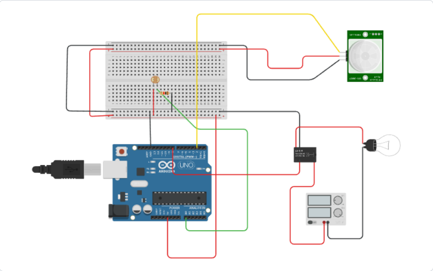
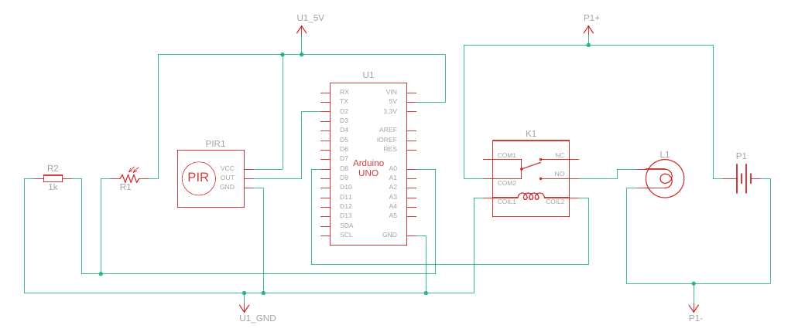

# Smart Home Automation using PIR and Light Sensor

This project demonstrates an **energy-efficient home automation system** using Arduino UNO, a PIR motion sensor, and a Light Dependent Resistor (LDR). The system automatically controls a bulb based on **motion detection** and **ambient light level**.

---

## 📷 Project Overview

- **Motion Detection:** Detects presence using a PIR sensor.
- **Light Sensing:** Measures light intensity to distinguish between day and night.
- **Automation Logic:** Bulb turns ON **only** when:
  - Motion is detected **AND**
  - Light intensity is below threshold (dark environment).
- **Energy Saving:** Prevents the bulb from turning ON during daytime even if motion is detected.

---

## 🛠️ Components Used

- Arduino UNO
- PIR Motion Sensor
- LDR (Light Dependent Resistor)
- 1kΩ Resistor
- Relay Module (SPDT)
- AC Bulb (230V)
- Breadboard and jumper wires
- Power Supply

---

## ⚡ Circuit Diagram

### Breadboard Wiring (Tinkercad)



### Schematic



A full-resolution version of the schematic is available as a [PDF](images/schematic.pdf).

---

## 🧩 Arduino Code (Simple Version)

```cpp
#define PIR_PIN 2
#define RELAY_PIN 8
#define LDR_PIN A0

void setup() {
  pinMode(PIR_PIN, INPUT);
  pinMode(RELAY_PIN, OUTPUT);
  digitalWrite(RELAY_PIN, HIGH); // Relay OFF initially
  Serial.begin(9600);
}

void loop() {
  int ldrValue = analogRead(LDR_PIN);
  int motionDetected = digitalRead(PIR_PIN);

  Serial.print("LDR: ");
  Serial.print(ldrValue);
  Serial.print("  PIR: ");
  Serial.println(motionDetected);

  if (motionDetected == HIGH && ldrValue < 600) {
    digitalWrite(RELAY_PIN, LOW); // Turn ON light
  } else {
    digitalWrite(RELAY_PIN, HIGH); // Turn OFF light
  }
  delay(500);
}
